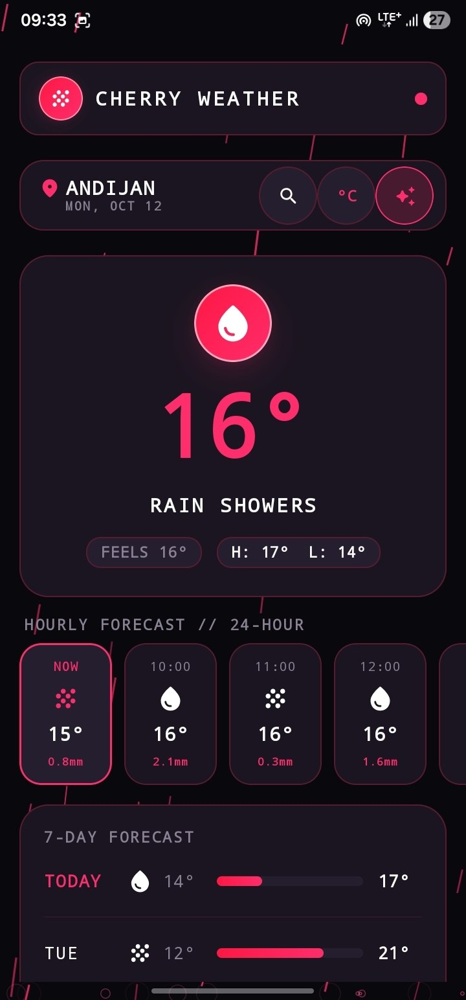
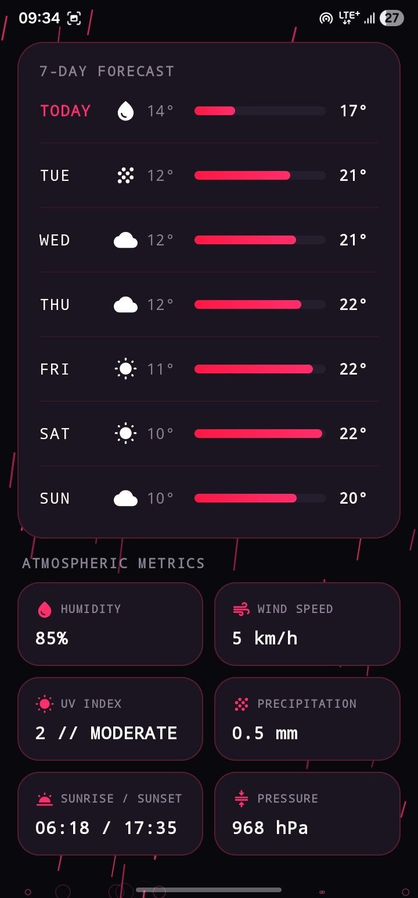
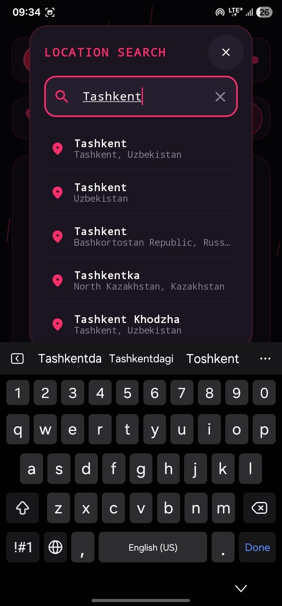

<div align="center">

# 🍒 Cherry Weather

[](https://kotlinlang.org)
[](https://developer.android.com/jetpack/compose)
[](https://m3.material.io)
[](https://opensource.org/licenses/MIT)

**A modern, beautifully crafted Android weather application built entirely with Jetpack Compose, featuring real-time Open-Meteo forecasts, dynamic custom Canvas weather animations, location onboarding, unit toggling, and robust DataStore persistence.**

</div>

---

## 📱 Overview

**Cherry Weather** is a premium weather companion designed for Android with a delightful Material 3 Expressive aesthetic. It provides instant access to hyper-local weather conditions, 24-hour hourly trends, 7-day daily forecasts, and advanced meteorological details (UV index, wind speed, humidity, pressure, visibility, and dew point). 

Powered by the free **Open-Meteo API**, Cherry Weather requires no API keys to get started, ensuring zero-configuration setup for developers and users alike.

---

## ✨ Key Features

- **🌤️ Open-Meteo Weather Integration**: Fast, reliable, and keyless real-time weather data, hourly forecasts, and 7-day outlooks.
- **📍 Smart Location Onboarding & Geocoding**: Automatic GPS location detection via device location services combined with an interactive city search dialog supporting geocoding auto-complete.
- **🎨 Immersive Custom Canvas Animations**: Dynamic particle and vector weather effects rendered via Jetpack Compose `Canvas`—watch rain drops fall, snow drift, clouds float, and sun rays beam depending on live weather conditions.
- **🌡️ Instant Unit Toggle**: Seamlessly switch between Metric (`°C`, `km/h`) and Imperial (`°F`, `mph`) with reactive UI updates across all components.
- **💾 Jetpack DataStore Caching**: Persistent user preferences and cached weather responses ensure lightning-fast cold starts and offline resilience.
- **🎨 Material 3 Expressive & Edge-to-Edge**: Full edge-to-edge layout immersion with dynamic color support (Material You), smooth state transitions, and polished loading skeletons.

---

## 📸 Screenshots

| Home | Details | Search |
|---|---|---|
|  |  |  |

---

## 🛠️ Tech Stack & Architecture

- **UI Framework**: [Jetpack Compose](https://developer.android.com/jetpack/compose) with [Material 3](https://m3.material.io) (Expressive components, dynamic theming).
- **Architecture**: MVVM (Model-View-ViewModel) with Kotlin Coroutines and `StateFlow` for unidirectional data flow.
- **Networking**: OkHttp & Moshi for robust HTTP requests and JSON parsing.
- **Local Storage**: Jetpack Preferences DataStore for type-safe preference management.
- **Location**: Android Location Services & Geocoding API.
- **Testing**: JUnit 4, Kotlin Coroutines Test, and MockK for comprehensive unit and repository testing.

---

## 📂 Project Structure

```tree
com.asta.cherryweather/
│
├── data/
│   ├── local/
│   │   └── UserPreferencesRepository.kt     # DataStore preferences management
│   ├── location/
│   │   └── LocationService.kt               # GPS location provider & permissions
│   ├── model/
│   │   ├── WeatherResponse.kt               # Open-Meteo API response models
│   │   ├── GeocodingResponse.kt             # City search geocoding models
│   │   └── TemperatureUnit.kt               # Metric / Imperial unit enum
│   ├── remote/
│   │   ├── NetworkClient.kt                 # OkHttp / Moshi client setup
│   │   ├── OpenMeteoApiService.kt           # Weather API endpoints
│   │   └── GeocodingApiService.kt           # Geocoding search API endpoints
│   └── repository/
│       └── WeatherRepository.kt             # Single source of truth for weather data
│
├── ui/
│   ├── components/
│   │   ├── CherryTopBar.kt                  # App bar with search & unit toggle
│   │   ├── CherryHeroSection.kt             # Current weather highlight card
│   │   ├── CherryHourlyForecast.kt          # Horizontal 24-hour forecast strip
│   │   ├── CherryDailyForecastCard.kt       # 7-day extended forecast view
│   │   ├── CherryDetailsGrid.kt             # Detailed weather metrics grid
│   │   ├── CherrySearchDialog.kt            # City search & selection dialog
│   │   ├── CherryLocationPermission.kt      # Location onboarding flow
│   │   ├── CherryLoadingSkeleton.kt         # Shimmer loading placeholders
│   │   └── canvas/
│   │       └── CherryWeatherCanvasAnimation.kt # Dynamic custom canvas weather effects
│   ├── theme/
│   │   ├── Color.kt                         # Material color tokens & palettes
│   │   ├── Theme.kt                         # Dynamic Material 3 theme wrapper
│   │   └── Type.kt                          # Typography definitions
│   └── utils/
│       ├── WeatherUtils.kt                  # Formatting & weather code mappers
│       └── SampleData.kt                    # Previews & offline mock data
│
├── viewmodel/
│   └── WeatherViewModel.kt                  # UI state holder & business logic
└── MainActivity.kt                          # App entry point & lifecycle host
```

---

## 🚀 Getting Started

### Prerequisites
- [Android Studio](https://developer.android.com/studio) Ladybug or newer.
- JDK 17 or higher.
- Android SDK 34+ (Target SDK 35).

### Installation & Running

1. **Clone the repository**:
   ```bash
   git clone https://github.com/asta-JC/Cherry-Weather.git
   cd Cherry-Weather
   ```

2. **Open in Android Studio**:
   - Select **Open an Existing Project** and choose the `Cherry-Weather` root folder.
   - Let Gradle sync dependencies automatically.

3. **Build and Run**:
   - Connect an Android device or start an emulator (API 26+).
   - Run the app via Android Studio or execute via terminal:
     ```bash
     ./gradlew assembleDebug
     ```

4. **Run Unit Tests**:
   ```bash
   ./gradlew testDebugUnitTest
   ```

---

## 🤝 Contributing

Contributions, bug reports, and feature requests are welcome! Feel free to check out the [issues page](https://github.com/asta-JC/Cherry-Weather/issues).

1. Fork the Project
2. Create your Feature Branch (`git checkout -b feature/AmazingFeature`)
3. Commit your Changes (`git commit -m 'Add some AmazingFeature'`)
4. Push to the Branch (`git origin push feature/AmazingFeature`)
5. Open a Pull Request

---

## 📄 License

This project is developed as part of Asta's project series. Feel free to use and adapt for personal and educational use!

---

<p align="center">
  Made with ❤️ & 🍒 by Asta
</p>
