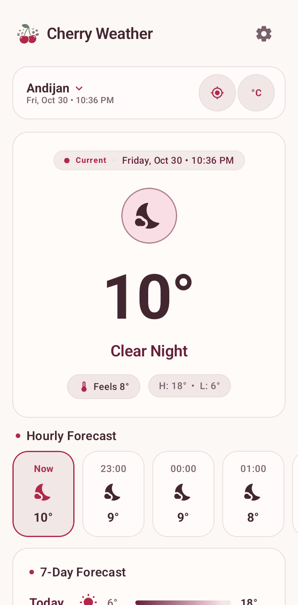
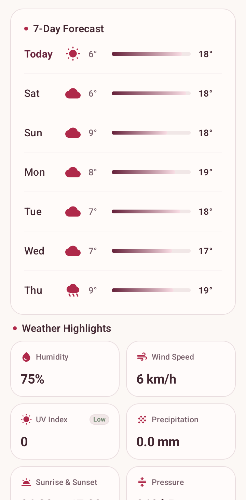
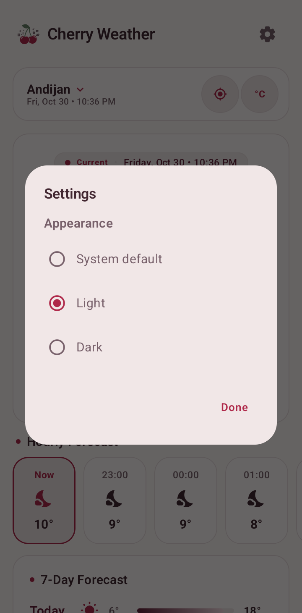

<div align="center">
  
  <h1>Cherry Weather</h1>
  <p><strong>A softer view of your forecast.</strong></p>
  <p>Current conditions, hourly forecasts, and a seven-day outlook in a calm CherryApp interface.</p>
  <p>
    
    
    
  </p>
  <p><a href="https://github.com/asta-JC/Cherry-Weather/releases/download/v1.1/Cherry-Weather_v1.1.apk">Download APK</a> · <a href="https://github.com/asta-JC/Cherry-Weather/releases/tag/v1.1">Release notes</a></p>
  <p>
    <a href="#screenshots">Screenshots</a> ·
    <a href="#features">Features</a> ·
    <a href="#getting-started">Get started</a> ·
    <a href="https://github.com/asta-JC/Cherry-Weather/issues">Feedback</a>
  </p>
</div>

---

## Overview

Cherry Weather brings current conditions and upcoming weather together in one scrollable view. Search for a city or use your location, compare hourly and daily forecasts, and keep your preferred appearance and temperature units between visits.

## Screenshots

<table>
  <tr><th width="33%">Current weather</th><th width="33%">Forecast</th><th width="33%">Settings</th></tr>
  <tr>
    <td align="center"></td>
    <td align="center"></td>
    <td align="center"></td>
  </tr>
  <tr><td align="center">Conditions at a glance.</td><td align="center">Plan the days ahead.</td><td align="center">Choose your appearance.</td></tr>
</table>

Captured from the production app on a physical Samsung Galaxy S22 Ultra in Light mode. These are real forecast screens, not mockups; system status and navigation bars are cropped out.

## Features

- **Current and upcoming weather** — see current conditions, hourly temperatures, and a seven-day forecast from Open-Meteo.
- **City search and recent locations** — search by city name and return to recently viewed places, or request the phone's location.
- **Weather highlights** — check humidity, wind, UV index, precipitation, sunrise/sunset, and pressure.
- **Instant unit switching** — switch between Celsius and Fahrenheit with matching wind and precipitation units.
- **Saved appearance** — choose System default, Light, or Dark in Settings; your choice survives app restarts.
- **Cached forecasts** — retain the last forecast and location locally, with pull-to-refresh for updated conditions when connected.

## Compatibility

| Area | Support |
| --- | --- |
| Platform | Android app; minimum SDK 24 (Android 7.0), target/compile SDK 37 |
| Data | Internet required for fresh forecasts and city search |
| Location | Optional coarse/fine location permission; manual city search is available |
| Known limit | Existing `java.time` calls lack desugaring for API 24–25; Android 7 date/time compatibility remains unresolved. Physical-device checks used a newer Android version. |

## Getting started

### Download

Install [Cherry-Weather_v1.1.apk](https://github.com/asta-JC/Cherry-Weather/releases/download/v1.1/Cherry-Weather_v1.1.apk) from [GitHub Releases](https://github.com/asta-JC/Cherry-Weather/releases/tag/v1.1).

This APK is **debug/test-signed** with the existing Android Debug certificate, not production signing. Version: **1.1**, versionCode **2**, package `com.asta.cherryweather`. Verify the download with [SHA256SUMS.txt](https://github.com/asta-JC/Cherry-Weather/releases/download/v1.1/SHA256SUMS.txt).

### Requirements

- A JDK compatible with Gradle 9.6 and Android Gradle Plugin 9.4.1; this build was verified with JDK 25.
- Android SDK Platform 37 and Android SDK build tools.
- A physical Android phone with USB debugging enabled for installation.

### Build and run

```bash
git clone https://github.com/asta-JC/Cherry-Weather.git
cd Cherry-Weather
./gradlew assembleDebug
adb devices
adb -s YOUR_DEVICE_SERIAL install -r app/build/outputs/apk/debug/app-debug.apk
```

Open Cherry Weather on the phone. Select a city, or allow location access to load a local forecast. No API key is configured for the existing Open-Meteo endpoints.

### Tests

```bash
./gradlew testDebugUnitTest
./gradlew lintDebug
```

The existing unit suite passes. Lint currently reports 22 `NewApi` errors in the date/time utilities described above.

## Built with

| Layer | Technology |
| --- | --- |
| Interface | Kotlin, Jetpack Compose, Material 3 |
| State | ViewModel, StateFlow, lifecycle-aware Compose collection |
| Network | Retrofit, OkHttp, Moshi, Open-Meteo forecast and geocoding APIs |
| Preferences and cache | Jetpack Preferences DataStore |
| Location | Google Play services location |
| Build | Gradle 9.6, Android Gradle Plugin 9.4.1 |

## What's new in 1.1

- Shared cream, rose, and plum CherryApp styling with full header and launcher branding.
- Settings for System default, Light, and Dark appearance.
- Calmer forecast cards with larger touch targets, wrapping labels, and cutout-safe spacing.
- Direct launch into weather content without a custom splash screen.

## Feedback

[Open an issue](https://github.com/asta-JC/Cherry-Weather/issues) with your app version, Android version, device model, and steps to reproduce. Use non-sensitive screenshots and avoid sharing precise personal coordinates.

## License & credits

This project is developed as part of Asta's project series. Feel free to use and adapt for personal and educational use!

Weather forecasts and city search are provided by [Open-Meteo](https://open-meteo.com/). Third-party libraries retain their respective licenses.

---

<p align="center">
  <strong>Made with ❤️ &amp; 🍒 by Asta</strong><br />
  <sub>Part of the CherryApp family.</sub>
</p>
